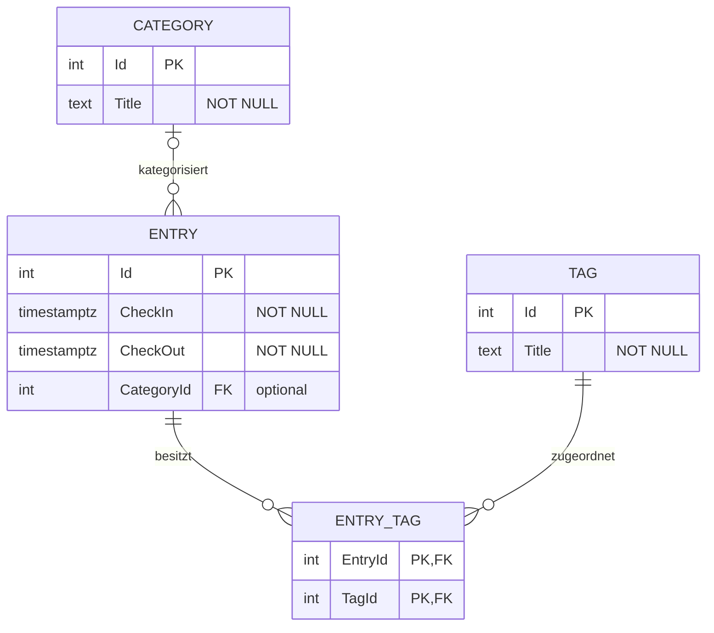

# Lösungsvorschlag Aufgabe 3.1 – Datenmodell erweitern (.NET)

Branch: `block3/3-1-datenmodellErweitern`, analog zum Quarkus-Projekt.
Grundlage ist der Commit `8258e16` von Aufgabe 2.2 auf `block2/2-2-dto`.
Die Änderungen für Aufgabe 3.1 bleiben separat uncommittet.
.NET 10 und EF Core/Npgsql 10 bleiben unverändert.

## ERD

