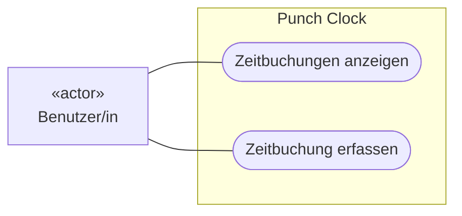
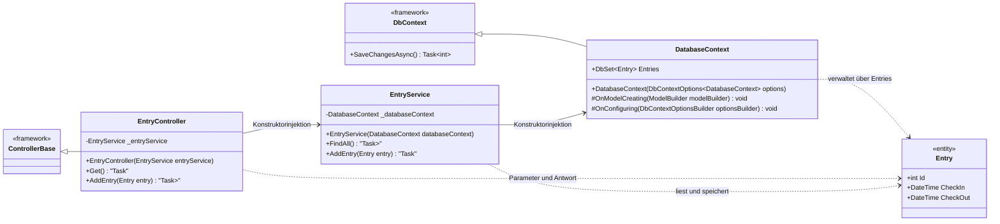
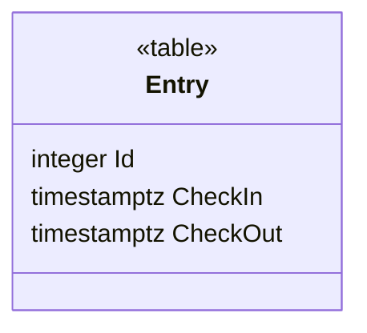
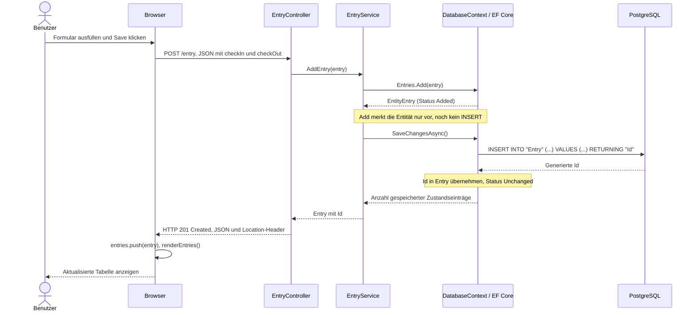
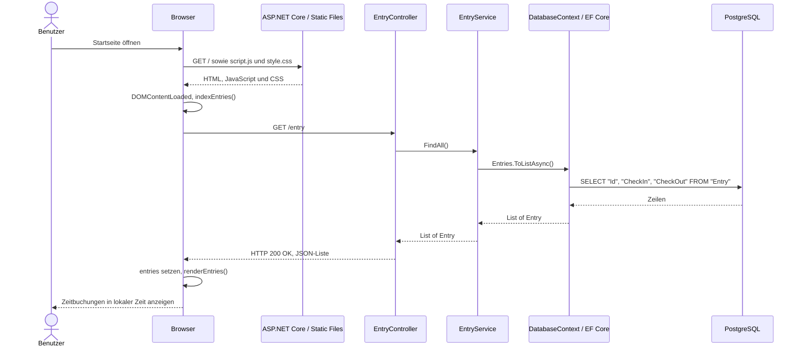

# Lösungsvorschlag: Aufgabe 1.4 – Übungsprojekt analysieren (.NET)

## 2. UML-Anwendungsfalldiagramm
Mermaid unterstützt keine native UML-Anwendungsfalldiagramm-Syntax. Deshalb stellt ein Flowchart den Akteur, die Systemgrenze und die ovalen Anwendungsfälle dar. Die Verbindungen sind ungerichtete UML-Assoziationen.

## 3. UML-Klassendiagramm des Backends

Frameworkklassen sind auf die relevanten Mitglieder reduziert. Generische Rückgabetypen sind mit C#-Schreibweise in Anführungszeichen dargestellt; Properties besitzen öffentliche Getter und Setter.

## 4. Entity Relationship Diagram als UML-Klassendiagramm

| C#-Property | PostgreSQL-Spalte | SQL-Typ | Einschränkungen |
| --- | --- | --- | --- |
| `Id: int` | `"Id"` | `integer` | Primärschlüssel, NOT NULL, GENERATED BY DEFAULT AS IDENTITY |
| `CheckIn: DateTime` | `"CheckIn"` | `timestamp with time zone` | NOT NULL |
| `CheckOut: DateTime` | `"CheckOut"` | `timestamp with time zone` | NOT NULL |

Erwartetes Schema aus EF-Mapping und Npgsql-Konventionen: `public."Entry"`. Es gibt eine fachliche Tabelle und noch keine Fremdschlüssel oder Beziehungen. Die Identity-Sequenz ist keine zusätzliche Entität. Das Schema ist hier aus dem Code abgeleitet; die Abfrage in der README erlaubt den Abgleich mit der laufenden Datenbank.

`ToTable("Entry")` legt den Tabellennamen fest. Gross-/Kleinschreibung erfordert die doppelten Anführungszeichen in SQL. Der Browser sendet mit `toISOString()` UTC-Zeitpunkte (`Z`); Npgsql speichert diese als `timestamp with time zone`. Die ursprüngliche Zeitzone wird dabei nicht gespeichert. Die Anzeige erfolgt über `toLocaleString()` in der lokalen Browser-Zeitzone.

Quellen: [Npgsql Identity-Spalten](https://www.npgsql.org/efcore/modeling/generated-properties.html), [Npgsql Zeitstempel-Mapping](https://www.npgsql.org/efcore/release-notes/6.0.html).

## 5. Sequenzdiagramme

Gezeigt werden erfolgreiche Abläufe. ASP.NET Core übernimmt Routing, JSON-Deserialisierung, Modellvalidierung und Serialisierung; EF Core/Npgsql übernimmt den SQL-Zugriff. Die asynchronen Aufrufe werden jeweils abgewartet.

### 5.1 Zeitbuchung erfassen

### 5.2 Zeitbuchungen anzeigen

